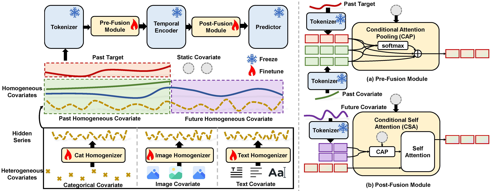

# UniCA + Chronos-Bolt en M5

Versión reducida de [UniCA](https://arxiv.org/abs/2506.22039) (repo oficial) enfocada en un solo caso:

- **Modelo base (TSFM):** [Chronos-Bolt-base](https://huggingface.co/amazon/chronos-bolt-base), congelado.
- **Dataset:** M5 (ventas diarias de Walmart, horizonte de 28 días), con sus covariables.

UniCA es un adaptador: homogeneiza las covariables (estáticas, dinámicas pasadas y futuras) al espacio de
tokens de Chronos-Bolt y las fusiona por atención/gating, sin modificar los pesos del modelo preentrenado.



---

## Estructura

```
main.py                         # entrena/evalúa y reporta métricas (gluonts) normalizadas vs naive.json
utils.py                        # argumentos CLI y carga del dataset M5
scripts/m5.sh                   # baseline zero-shot + UniCA
data/
  prepare_m5.py                 # convierte los CSV de Kaggle al formato del proyecto
  unimodal/data.py              # Dataset (HF datasets -> gluonts), splits train/val/test de M5
  loader.py, transform.py,
  sampler.py                    # muestreo de ventanas y transformaciones
  dataset_properties.json
models/
  utils.py                      # get_predictor: 'ts_adapter/unica', 'chronos_bolt' o 'naive'
  predictor/chronos.py          # predictor zero-shot de Chronos-Bolt
  predictor/naive.py            # Naive (statsforecast), referencia para naive.json
  wrapper/fm/chronos_wrapper.py # expone tokenize/encode/decode de Chronos-Bolt
  adapter/estimator.py          # estimador gluonts + Lightning
  adapter/lightning_module.py
  adapter/layers.py             # GRN, VSN, GLU (bloques tipo TFT)
  adapter/unica/module.py       # el modelo UniCA
naive.json                      # métricas de referencia (Naive) para normalizar
```

## Instalación

```bash
conda create -n unica python=3.10
conda activate unica
pip install -r requirements.txt
```

## Datos y modelo

Se usan los CSV originales de la competencia
[M5 Forecasting - Accuracy](https://www.kaggle.com/competitions/m5-forecasting-accuracy/data)
(`calendar.csv`, `sales_train_evaluation.csv`, `sell_prices.csv`). Se convierten una vez al formato
HF-datasets que lee el código (tarda ~2-3 min, ocupa ~1.2 GB, y `datos/` está en `.gitignore`):

```bash
python data/prepare_m5.py --csv_dir /ruta/m5-forecasting-accuracy --out datos/m5/M5_test
# para pruebas rápidas: --num_series 1000
export DATA_PATH=$(pwd)/datos
export MODEL_PATH=/ruta/a/modelos   # opcional
```

Cada serie (producto x tienda, 30.490 en total) incluye:

| Campo | Contenido |
|---|---|
| `target` | ventas diarias desde el primer día con precio |
| `feat_static_cat` | item, departamento, categoría, tienda, estado |
| `feat_dynamic_real` | precio, SNAP del estado, eventos (Cultural, National, Religious, Sporting) |

El test son los últimos 28 días (d_1914-d_1941, periodo de evaluación oficial de M5). Con esta
conversión el baseline Naive reproduce exactamente el MAE/MSE/MAPE de `naive.json` del paper.

Si `$MODEL_PATH/chronos-bolt-base` no existe, el modelo se descarga automáticamente desde HuggingFace
(`amazon/chronos-bolt-base`).

## Ejecución

```bash
wandb login            # o usa --wandb_mode offline / disabled
bash scripts/m5.sh
```

O por separado:

```bash
# Baseline zero-shot (sin covariables)
python main.py --model_name chronos_bolt --datasets m5

# Naive (referencia de normalización)
python main.py --model_name naive --datasets m5

# UniCA
python main.py --model_name ts_adapter/unica --datasets m5 \
  --with_gate --with_future --future_with_gate \
  --num_batches_per_epoch 50 --max_epochs 100 \
  --indexed_sample --split_val --gradient_clip 0.1 --batch_size 128
```

Los resultados normalizados (MAE, MSE, MAPE, CRPS divididos por los del Naive) se guardan en
`results/<model_name>/normalized_results.csv` y en la tabla `Datasets Evaluation` de wandb.

### Flags principales de UniCA

| Flag | Efecto |
|---|---|
| `--with_gate` | gate sobre la fusión de covariables pasadas |
| `--with_future` | usa covariables futuras conocidas (calendario, precios, eventos) vía atención |
| `--future_with_gate` | gate sobre la fusión de covariables futuras |
| `--past_pos / --future_pos` | fusión `pre` o `post` encoder de Chronos-Bolt |
| `--no_static` / `--no_past` | ablaciones: sin covariables estáticas / pasadas |
| `--wo_time` | sin features de calendario generadas por gluonts |
